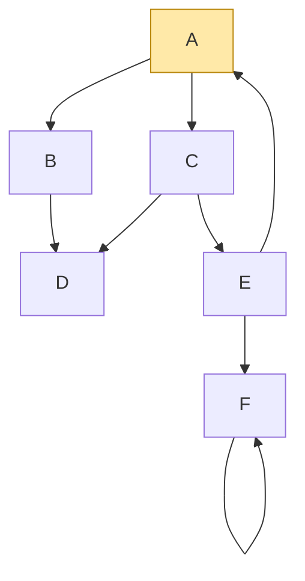
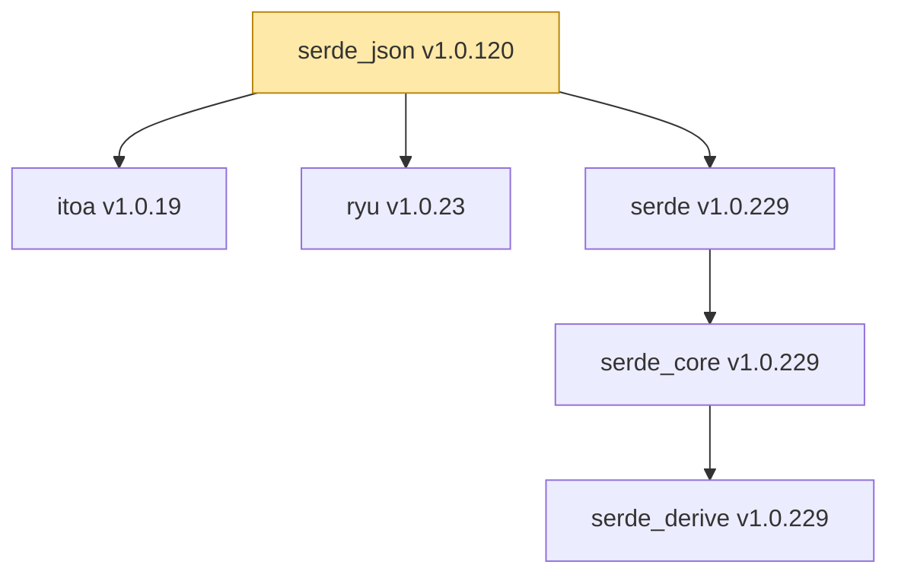

# depviz — граф зависимостей пакетов Cargo (вариант 17)

Практическая работа №2 по дисциплине «Конфигурационное управление».

**Выполнила:** Лукина Ирина Константиновна, группа ИКБО-30-25.

## 1. Общее описание

`depviz` — консольный инструмент визуализации графа зависимостей пакетов
языка Rust (менеджер пакетов Cargo). Он получает описание пакета из
индекса реестра crates.io, строит граф прямых и транзитивных зависимостей
и выводит его:

* на языке диаграмм **Mermaid**;
* в виде изображения **SVG**;
* в виде **ASCII-дерева**, как `cargo tree`.

Готовые средства получения зависимостей (`cargo`, `cargo metadata`,
библиотеки для работы с реестром) **не используются**: файлы индекса
скачиваются через стандартный `urllib`, а JSON, требования к версиям
(SemVer) и YAML разбираются кодом проекта.

Язык — Python 3.8+, только стандартная библиотека.

### Этапы и коммиты

| Этап | Содержание | Коммит |
|------|------------|--------|
| 1. Прототип с конфигурацией | YAML-файл, вывод параметров, обработка ошибок | `feat(config)` |
| 2. Сбор данных | прямые зависимости версии пакета из индекса Cargo | `feat(cargo)` |
| 3. Основные операции | граф через рекурсивный BFS, глубина, фильтр, циклы, тестовый режим | `feat(graph)` |
| 4. Дополнительные операции | обратные зависимости | `feat(reverse)` |
| 5. Визуализация | Mermaid, SVG, ASCII-дерево, сравнение с `cargo tree` | `feat(visual)` |

### Структура репозитория

```
├── src/depviz/
│   ├── __main__.py       точка входа (python3 -m depviz)
│   ├── cli.py            аргументы командной строки и режимы работы
│   ├── yaml_lite.py      разбор YAML-файла конфигурации
│   ├── config.py         параметры и их проверка
│   ├── semver.py         версии и требования к версиям (^, ~, =, >=, *)
│   ├── cargo_index.py    загрузка и разбор индекса Cargo
│   ├── sources.py        источник зависимостей для реального репозитория
│   ├── test_repo.py      тестовый репозиторий (пакеты A–Z)
│   ├── graph.py          граф и рекурсивный BFS, поиск циклов
│   ├── reverse.py        обратные зависимости
│   ├── report.py         вывод уровней и рёбер (этап 3)
│   ├── ascii_tree.py     ASCII-дерево
│   ├── mermaid.py        текст Mermaid
│   └── svg.py            изображение SVG
├── tests/                модульные тесты (unittest)
├── examples/
│   ├── configs/          готовые файлы конфигурации для всех этапов
│   ├── errors/           конфигурации с ошибками (этап 1)
│   ├── repos/            тестовые репозитории
│   └── build_mini_index.py  учебный индекс для работы без интернета
├── scripts/              скрипты демонстрации этапов
├── config.yaml           пример конфигурации
├── run.sh                скрипт запуска
└── Makefile
```

## 2. Функции и настройки

### 2.1. Запуск

```sh
./run.sh [-c FILE] [--show-config] [--direct] [--levels]
```

| Аргумент | Назначение |
|----------|------------|
| `-c FILE`, `--config FILE` | файл конфигурации (по умолчанию `config.yaml`) |
| `--show-config` | вывести все параметры в формате `ключ = значение` (этап 1) |
| `--direct` | вывести только прямые зависимости (этап 2) |
| `--levels` | вывести уровни и рёбра графа (этап 3) |

Без дополнительных ключей программа строит граф и визуализирует его
(этап 5), а при `reverse_deps: true` выводит обратные зависимости (этап 4).

Коды завершения: `0` — успех, `1` — ошибка получения данных,
`2` — ошибка конфигурации.

### 2.2. Параметры конфигурации (YAML)

```yaml
package: serde_json              # имя анализируемого пакета
repository: https://index.crates.io
test_mode: false                 # true — repository указывает на файл
version: 1.0.120                 # версия пакета
output_image: graph.svg          # файл изображения
ascii_tree: true                 # выводить ASCII-дерево
max_depth: 3                     # максимальная глубина анализа
filter_substring: ""             # пропускать пакеты с этой подстрокой
reverse_deps: false              # режим обратных зависимостей
```

| Параметр | Тип | По умолчанию | Проверка |
|----------|-----|--------------|----------|
| `package` | строка | обязателен | буквы, цифры, `_`, `-` |
| `repository` | строка | обязателен | URL `http(s)://…`; в тестовом режиме — существующий файл |
| `test_mode` | true/false | `false` | логическое значение |
| `version` | строка | — | `X.Y.Z` (обязательна вне тестового режима) |
| `output_image` | строка | `graph.svg` | имя файла `*.svg` |
| `ascii_tree` | true/false | `false` | логическое значение |
| `max_depth` | целое | `5` | от 1 до 100 |
| `filter_substring` | строка | `""` | строка (пустая — без фильтра) |
| `reverse_deps` | true/false | `false` | логическое значение |

Также проверяются: синтаксис YAML (с номером строки), неизвестные и
повторяющиеся ключи, отсутствие обязательных параметров, вложенные
структуры (не поддерживаются).

### 2.3. Получение данных (Cargo)

Индекс crates.io доступен по «разреженному» протоколу: для каждого пакета
есть файл, где каждая строка — JSON-описание одной версии с её
зависимостями. Путь к файлу строится по длине имени:

| Имя | Путь |
|-----|------|
| `a` | `1/a` |
| `ab` | `2/ab` |
| `abc` | `3/a/abc` |
| `serde_json` | `se/rd/serde_json` |

Учитываются зависимости, нужные для сборки пакета: вида `normal` и
`build`, кроме необязательных (`optional`). Зависимости для тестов (`dev`)
не учитываются. Версия транзитивной зависимости — наибольшая не отозванная
(`yanked`) версия, подходящая под требование (`^1.0`, `~0.4`, `>=1, <2`…).

### 2.4. Граф зависимостей

* Обход в ширину (**BFS**), реализованный **рекурсией по уровням**:
  функция обрабатывает текущий уровень, собирает следующий и вызывает
  себя для него.
* `max_depth` — число уровней от корня; пакеты глубже не исследуются.
* Пакеты, в имени которых есть `filter_substring`, исключаются вместе с
  их зависимостями.
* Каждый пакет попадает в граф один раз, поэтому **циклы** не зацикливают
  обход; найденные циклы выводятся отдельно.

### 2.5. Тестовый режим

При `test_mode: true` параметр `repository` — путь к файлу графа, где
пакеты называются большими латинскими буквами:

```
# комментарий
A: B C      # A зависит от B и C
B: D
D:          # нет зависимостей
```

### 2.6. Обратные зависимости

При `reverse_deps: true` выводятся пакеты, которые зависят от `package`,
по уровням. Используется тот же рекурсивный BFS по перевёрнутому графу.
Режим работает с тестовым репозиторием: для crates.io пришлось бы
скачать весь индекс.

### 2.7. Визуализация

* **Mermaid** — текст `graph TD` печатается на экран (его можно вставить
  в README на GitHub или в редактор mermaid.live).
* **SVG** — сохраняется в `output_image`. Уровни графа расположены сверху
  вниз, корень выделен цветом, рёбра внутри уровня — дугами снизу,
  циклические рёбра — красными пунктирными дугами и петлями.
* **ASCII-дерево** — при `ascii_tree: true`; повторно встреченный пакет
  помечается `(*)` и не раскрывается, как в `cargo tree`.

## 3. Сборка и тесты

Сборка не требуется, нужен только Python 3.8+.

```sh
make test           # модульные тесты
make errors         # обработка ошибок конфигурации (этап 1)
make demo-graph     # графы тестовых репозиториев (этап 3)
make demo-reverse   # обратные зависимости (этап 4)
make demo-visual    # визуализация трёх пакетов тестового репозитория (этап 5)
make demo-real      # визуализация трёх пакетов crates.io (нужен интернет)
make serve          # учебный индекс на http://localhost:8000 (без интернета)
```

Изображения сохраняются в каталог `output/`, он не входит в репозиторий.

Тестовые репозитории в `examples/repos/`:

| Файл | Что показывает |
|------|----------------|
| `simple.txt` | обычное дерево |
| `diamond.txt` | общая зависимость двух пакетов («ромб») |
| `cycle.txt` | цикл `A → C → E → A` и петля `F → F` |
| `deep.txt` | длинная цепочка для `max_depth` |
| `filter.txt` | пакеты с общей подстрокой для фильтра |
| `invalid.txt` | ошибка формата |

## 4. Примеры использования

### 4.1. Параметры и ошибки (этап 1)

```
$ ./run.sh --show-config --direct
package = 'serde_json'
repository = 'https://index.crates.io'
test_mode = False
version = '1.0.120'
...
$ ./run.sh -c examples/errors/bad_version.yaml
Ошибка конфигурации: version: ожидалась версия вида 1.2.3, получено '1.0'
```

### 4.2. Граф с циклом (этапы 3 и 5)

```
$ ./run.sh -c examples/configs/visual_cycle.yaml
A
├── B
│   └── D
└── C
    ├── D (*)
    └── E
        ├── A (*)
        └── F
            └── F (*)

graph TD
    n0["A"]
    n1["B"]
    n2["C"]
    n3["D"]
    n4["E"]
    n5["F"]
    n0 --> n1
    n0 --> n2
    n1 --> n3
    n2 --> n3
    n2 --> n4
    n4 --> n0
    n4 --> n5
    n5 --> n5
    style n0 fill:#ffe9a8,stroke:#b8860b
Циклическая зависимость: A -> C -> E -> A
Циклическая зависимость: F -> F
Изображение графа сохранено: output/visual_cycle.svg
```

Тот же граф в Mermaid:



### 4.3. Глубина и фильтр (этап 3)

```
$ ./run.sh -c examples/configs/filter_log.yaml --levels
Граф зависимостей APP (max_depth=10, filter_substring='LOG')
  уровень 0: APP
  уровень 1: CORE, TESTKIT
  уровень 2: UTIL, MOCK
Рёбра (4):
  APP -> CORE
  APP -> TESTKIT
  CORE -> UTIL
  TESTKIT -> MOCK
Исключены фильтром: LOG, LOGX
```

### 4.4. Обратные зависимости (этап 4)

```
$ ./run.sh -c examples/configs/reverse_cycle.yaml
Обратные зависимости D (пакеты, которые зависят от D):
  уровень 1: B, C
  уровень 2: A
  уровень 3: E
Связи (кто от кого зависит):
  B -> D
  C -> D
  A -> B
  A -> C
  E -> A
  C -> E
```

### 4.5. Реальные пакеты crates.io (этапы 2 и 5)

```sh
./run.sh -c examples/configs/real_serde_json.yaml --direct
make demo-real       # log 0.4.22, serde_json 1.0.120, rand 0.8.5
```

Без интернета те же действия можно показать на учебном индексе
вымышленных пакетов `mini-*` в формате crates.io:

```sh
make serve                          # в отдельном окне терминала
./scripts/demo_real.sh mini         # mini-app, mini-json, mini-cli
```

```
mini-app v1.1.0
├── mini-cli v0.3.4
│   ├── mini-log v0.4.20
│   │   └── mini-cfg v1.0.0
│   └── mini-str v1.1.3
├── mini-json v1.2.5
│   ├── mini-derive v1.0.7
│   │   └── mini-str v1.1.3 (*)
│   └── mini-str v1.1.3 (*)
└── mini-log v0.4.20 (*)
```

## 5. Сравнение со штатным инструментом `cargo tree`

### 5.1. Результаты depviz для трёх пакетов crates.io

Запуск `make demo-real` (`max_depth: 3`, индекс https://index.crates.io):

```
log v0.4.22

serde_json v1.0.120
├── itoa v1.0.19
├── ryu v1.0.23
└── serde v1.0.229
    └── serde_core v1.0.229
        └── serde_derive v1.0.229

rand v0.8.5
└── rand_core v0.6.4
```

Граф `serde_json` в Mermaid:



Прямые зависимости `serde_json 1.0.120` (`--direct`): `itoa ^1.0`,
`ryu ^1.0`, `serde ^1.0.194`; ещё 10 зависимостей — dev или optional —
не учитываются.

### 5.2. Сравнение с `cargo tree`

Штатный инструмент Cargo — `cargo tree`. Для сравнения создан пустой
проект с тремя зависимостями (нужен Rust, https://rustup.rs):

```sh
cargo new compare && cd compare
cargo add log@=0.4.22 serde_json@=1.0.120 rand@=0.8.5
cargo tree --depth 3 -e normal,build
```

Результат `cargo tree` (macOS):

```
compare v0.1.0 (/Users/iiaasjk/Downloads/compare)
├── log v0.4.22
├── rand v0.8.5
│   ├── libc v0.2.191
│   ├── rand_chacha v0.3.1
│   │   ├── ppv-lite86 v0.2.21
│   │   └── rand_core v0.6.4
│   └── rand_core v0.6.4 (*)
└── serde_json v1.0.120
    ├── itoa v1.0.19
    ├── ryu v1.0.23
    └── serde v1.0.229
        └── serde_core v1.0.229
```

Глубина в `cargo tree` считается от проекта `compare`, поэтому для самих
пакетов показано на один уровень меньше, чем в depviz.

| Пакет | depviz | `cargo tree` | Причина расхождения |
|-------|--------|--------------|---------------------|
| `log 0.4.22` | только `log` | только `log` | **совпадает**: все зависимости `log` необязательные, функций по умолчанию нет |
| `serde_json 1.0.120` | `itoa`, `ryu`, `serde → serde_core → serde_derive` | то же, но без `serde_derive` | зависимость `serde_core → serde_derive` объявлена для платформы `cfg(any())`, которая никогда не выполняется; Cargo её не подключает, depviz учитывает зависимости всех платформ. Версии `itoa`, `ryu`, `serde`, `serde_core` совпадают |
| `rand 0.8.5` | `rand_core` | `libc`, `rand_chacha` (→ `ppv-lite86`, `rand_core`), `rand_core` | `libc` и `rand_chacha` — необязательные зависимости, которые включают функции `std` и `std_rng`, стоящие у `rand` по умолчанию; depviz функции не вычисляет. Версия `rand_core` совпадает |

Проверка расхождения для `serde_json` — описание зависимостей `serde_core 1.0.229`
из индекса:

```
serde ^1 (dev)
serde_derive =1.0.229 (normal, target: cfg(any()))
serde_derive ^1 (dev)
```

### 5.3. Общие причины расхождений

1. **Функции (features) и необязательные зависимости.** `cargo tree`
   включает optional-зависимости, подключённые функциями по умолчанию;
   depviz optional-зависимости не учитывает.
2. **Зависимости для платформ** (`target`). `cargo tree` показывает
   зависимости только для текущей ОС; depviz — для всех платформ, включая
   условия вроде `cfg(any())`.
3. **Выбор версий.** `cargo tree` использует `Cargo.lock` и одну версию
   пакета на весь проект; depviz для каждого требования берёт наибольшую
   подходящую не отозванную версию на момент запуска. Поэтому версии
   транзитивных зависимостей со временем меняются (например, `serde`).
4. **dev-зависимости.** `cargo tree` без `-e normal,build` показывает
   dev-зависимости корневого пакета, depviz их не учитывает.
5. **Глубина.** `max_depth` в depviz соответствует `cargo tree --depth`.
